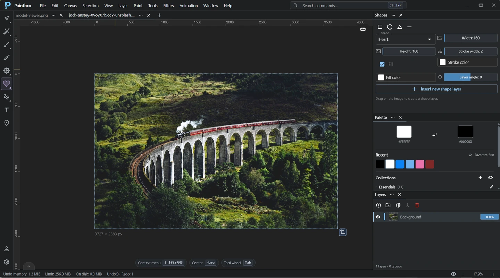
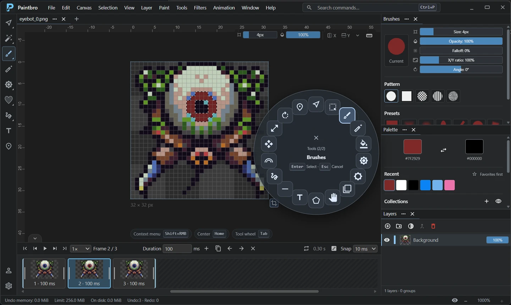
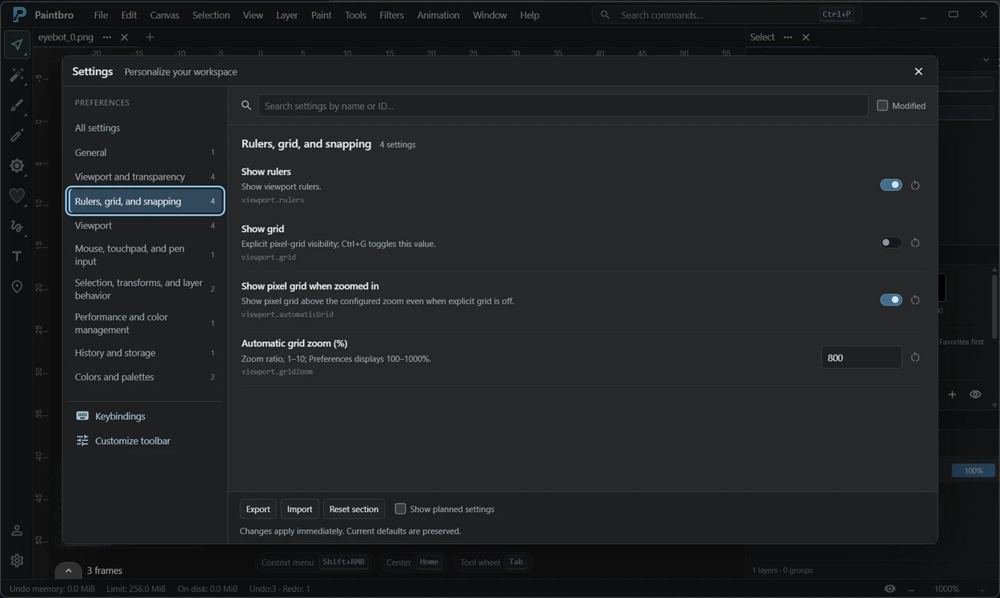

# Feature overview

ByteRich Paintbro provides raster painting, image editing, editable text and geometry, and frame-by-frame animation in a customizable Windows workspace.

## Brushes and color tools

Brush controls include size, opacity, falloff, aspect ratio, and angle, with selectable patterns and presets. Additional raster tools include eraser, flood fill, clone stamp, smudge, lighten, and darken.

The palette tracks recent colors and supports favorites. Mirror painting reflects strokes across the horizontal axis, vertical axis, or both, with adjustable axis positions.

The color picker includes a native Windows eyedropper for sampling anywhere on the screen, including outside Paintbro. Click to activate, click to pick, or press `Escape` to cancel. Sampled colors retain the current opacity, and advanced picker popups stay within the window.

## Layers and masks

Layers support groups, opacity, visibility, and locking. Multi-selection allows bulk edits and moving several layers together.

Layer masks control visibility without erasing the underlying pixels: paint black on a mask to hide and white to reveal. Switch between the image and mask as the active editing target.

## Selections, geometry, and transforms

Pixel selections support rectangle, ellipse, freehand, polygon, and magic-wand modes. Transform tools provide layer translation, scaling, and rotation; canvas cropping changes the document bounds.

Press `Ctrl+A` to select the entire canvas as a rectangle without rounded corners or feathering, regardless of the current selection tool settings.

Text and parametric shapes remain editable on their own layers. Geometry controls include fills, strokes, shape parameters, lines, curves, and arcs. Rulers, a pixel grid, and drawing guides support precise placement, with snapping and generators for parallel, radial, and grid guide sets.

## Adjustments and filters

Color adjustments include brightness/contrast, exposure, hue/saturation, levels, and color balance. Filters are available through the Filters menu and command search. The filter dialog provides a preview and before/after comparison before applying a change.

## Animation

The animation track below the canvas supports frame creation and duplication, per-frame duration, loop settings, and playback preview. Export the animation as GIF or save an individual frame as a static image.

## Workspace and keyboard controls

The workspace supports movable and resizable dock panels, configurable toolbar groups, a radial tool wheel accessed with `Tab`, and named layout presets. Settings are searchable; preferences and supported command bindings can be imported or exported as profiles.

Multiple documents open in tabs. Command search and contextual input hints provide access to editing operations without requiring every shortcut to be memorized. [Keyboard and workspace reference →](KEYBOARD-AND-WORKSPACE.md)

Open PNG, WebP, JPG/JPEG, GIF, and BMP images from command-line paths or Windows **Open with**. Installer and Microsoft Store packages register the supported file types while preserving existing default image applications. Paste a clipboard image into the empty workspace to create a new document with its original dimensions and transparency.

Compact titlebar menus switch instantly without overlapping flyouts. Elastic overscroll is disabled to prevent the entire app from shifting during laptop scrolling gestures.

## Export formats

Save static images as **PNG, JPEG, WebP, GIF, or BMP**. Save animations as **GIF**. The save dialog offers options for the chosen format, a preview, and reusable presets.

Exports store the rendered result. Layers, editable text and shapes, masks, guides, and undo history aren't preserved as an editable project. Output uses 8-bit color channels; source metadata and embedded ICC profiles aren't retained. [Saving and file-format limitations →](FAQ.md#how-does-saving-work)

[Get started](GETTING-STARTED.md) · [Download Paintbro](https://github.com/ByteRich/RichPaint/releases/latest) · [Back to the README](README.md)
