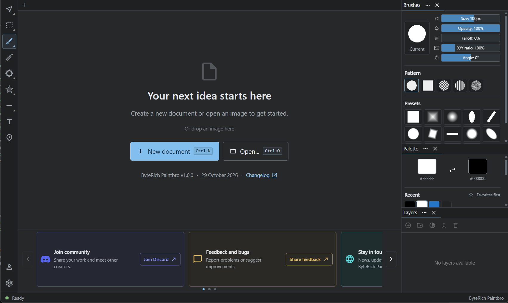

# Getting started

Install Paintbro, create or open a document, and save your first image.

## 1. Install or extract

Download a Windows package from [the latest release](https://github.com/ByteRich/RichPaint/releases/latest). Run the installer, or extract the portable ZIP and launch `paintbro.exe`.

Paintbro uses Microsoft Edge WebView2 Runtime. The installer can set it up if needed; the portable package needs it installed already. See the release notes for the packages available for your PC.

## 2. Create or open a document

On the welcome screen, choose **New document** (`Ctrl+N`) or **Open…** (`Ctrl+O`). You can also drop an image into the app.

## 3. Paint and edit

Choose a brush in the left toolbar, select a color in the Palette panel, and drag across the canvas. Use the Brushes panel to adjust size and opacity. Press `Ctrl+Z` to undo an edit.

Add layers in the Layers panel to keep image elements separate. Use the Text and Shapes tools to create editable objects on their own layers.

## 4. Navigate the workspace

- Scroll the mouse wheel over the canvas to zoom. Hold `Space` and move the pointer to pan, or drag with the middle mouse button.
- Press `Tab` over the canvas to open the tool wheel.
- Press `Ctrl+P` or `Ctrl+Shift+P` to search for a command.
- Press `Ctrl+,` to open Settings.

Touchpad navigation follows your input-device setting: two-finger scrolling pans and pinching zooms. [More workspace and keyboard tips →](KEYBOARD-AND-WORKSPACE.md)

## 5. Save your image

Press `Ctrl+Shift+S` for **Save as**, choose a name and image format, review the save options, and confirm. Use PNG when you want to keep transparent areas; use GIF for an animation.

**Saving produces an image, not an editable project.** Reopening it won't restore separate layers, text objects, masks, or undo history. Save versions as you go, and keep the document open while you still need to edit those parts. [More about saving →](FAQ.md#how-does-saving-work)

## Additional workflows

- **Layer masks:** right-click a layer, add a layer mask, select its mask thumbnail, then paint black to hide or white to reveal.
- **Animation:** expand the track below the canvas, enable animation mode, duplicate a frame, edit it, and preview playback. Save all frames as an animated GIF.
- **Layout presets:** use the Personalization icon above Settings to manage workspace layouts.

For help with a workflow, [ask the community](https://discord.gg/8pPUfE2Yv). Use [Share feedback](https://discord.gg/d8ChvYV9z) to report a bug or suggest an improvement.

[Capabilities](FEATURES.md) · [FAQ](FAQ.md) · [Back to the README](README.md)
