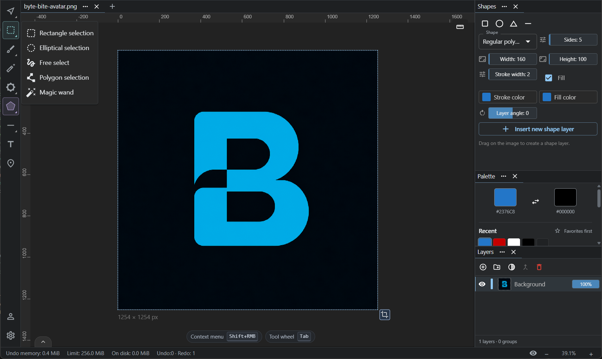

# ByteRich Paintbro

A free painting and raster image editor for Windows, with layers, masks, editable text and shapes, and frame-by-frame animation.

Paintbro combines a clean, customizable interface with command search and configurable keyboard shortcuts. ByteRich's focus is an accessible editing workflow: clear controls for beginners, precise tools, and efficient keyboard navigation.

**[Download the latest release](https://github.com/ByteRich/RichPaint/releases/latest)** · [Features](FEATURES.md) · [Getting started](GETTING-STARTED.md) · [Changelog](CHANGELOG.md)

## Features

- **Painting tools:** configurable brush size, opacity, falloff, aspect ratio, and angle; brush patterns and presets; eraser, flood fill, clone stamp, smudge, lighten, and darken.
- **Layers and masks:** layer groups, opacity, visibility, locking, multi-selection, and masks for editing visibility without erasing pixels.
- **Selections and transforms:** rectangle, ellipse, freehand, polygon, and magic-wand selections; layer translation, scaling, and rotation; canvas cropping.
- **Text and geometry:** editable text and parametric shapes with fill and stroke controls, plus lines, curves, and arcs.
- **Precision tools:** rulers, pixel grid, guide snapping, generated parallel/radial/grid guides, and mirror painting with adjustable axes.
- **Adjustments and filters:** brightness/contrast, exposure, hue/saturation, levels, color balance, and filter previews before applying changes.
- **Animation:** frame creation and duplication, per-frame timing, looping, playback preview, and animated GIF export.
- **Workspace customization:** tabbed documents, dockable panels, layout presets, configurable toolbar groups, a radial tool wheel, and preference/keybinding profile import and export.

See the [feature overview](FEATURES.md) for details. Open command search with `Ctrl+P` or `Ctrl+Shift+P`, the tool wheel with `Tab`, and Settings with `Ctrl+,`. Supported command bindings can be changed in **Keybindings**.

## Download and installation

Download a Windows package from the **Assets** section in [Releases](https://github.com/ByteRich/RichPaint/releases).

| Package | How to use it |
| --- | --- |
| Windows installer | Run the installer, then launch Paintbro. It can install the required Microsoft Edge WebView2 Runtime if it's missing. |
| Portable ZIP | Extract the whole archive, then run `paintbro.exe`. WebView2 must already be installed. |

Choose the architecture listed for your PC: **x64** for most Intel/AMD Windows PCs, or **ARM64** for Windows on ARM, when offered in the release. Check that release's notes for the available packages.

The portable package saves settings to `paintbro-saved/settings.json` beside `paintbro.exe`. Keep the included `paintbro-portable` marker beside the executable and move the settings folder with the app. Installed copies save settings to `%USERPROFILE%/Paintbro/settings.json`. Keyboard shortcuts are saved separately to `keybinding.json` in the same directory as `settings.json`. Recent-file information still lives in your Windows user profile.

## File formats and current limits

Static image export supports **PNG, JPEG, WebP, GIF, and BMP**. Animation export uses **GIF**. Save options include format-specific settings, a preview, and reusable presets.

Exports store the rendered image or animation. This release has no editable project format: layers, masks, editable objects, guides, and undo history aren't restored when an exported file is reopened. Output uses 8-bit color channels; source metadata and embedded ICC profiles aren't retained. See [saving and file formats](FAQ.md#how-does-saving-work).

## About this repository

This repository distributes **binary releases, release notes, and product documentation** for ByteRich Paintbro. Application source code isn't included. GitHub's automatically generated “Source code” archives contain this documentation repository; download the installer or portable ZIP to run Paintbro.

## Documentation

- [Getting started](GETTING-STARTED.md) — installation, document creation, editing, and saving.
- [Features](FEATURES.md) — painting, selections, layers, geometry, and animation.
- [Keyboard and workspace](KEYBOARD-AND-WORKSPACE.md) — default shortcuts, input gestures, and customization.
- [FAQ](FAQ.md) — platform requirements, distribution, and file-format limitations.
- [Changelog](CHANGELOG.md) — what's new in each release.

## Community and support

| Community | Feedback and bugs | Product updates |
| --- | --- | --- |
| Share artwork, discuss workflows, and ask questions. | Report bugs, suggest features, and discuss usability. | News and release information. |
| [Join Discord ↗](https://discord.gg/8pPUfE2Yv) | [Share feedback ↗](https://discord.gg/d8ChvYV9z) | [Visit Paintbro ↗](https://www.byterich.org/paintbro) |

For bug reports, include your Paintbro version, Windows version, and steps to reproduce the issue.

[More ByteRich applications ↗](https://www.byterich.org)
