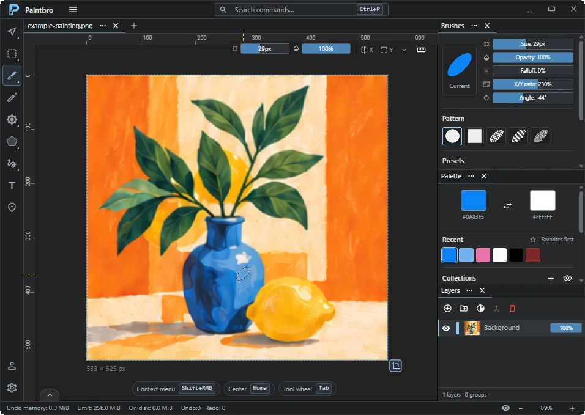

<h1 align="center">ByteRich Paintbro</h1>

  <strong>Paint, edit, and animate on Windows.</strong> 
  A free image editor with layers, editable objects, and a workspace you can make your own.

  <a href="https://github.com/ByteRich/RichPaint/releases/latest"><strong>Download Paintbro</strong></a>
  &nbsp;&middot;&nbsp;
  <a href="GETTING-STARTED.md">Getting started</a>
  &nbsp;&middot;&nbsp;
  <a href="FEATURES.md">Features</a>
  &nbsp;&middot;&nbsp;
  <a href="CHANGELOG.md">Changelog</a>

  
   
  A complete painting workspace, with your tools and colors close at hand.

## One workspace, many ways to create

**Paint and retouch.** Shape your brushes, work with color palettes, erase, fill, clone, and smudge. Preview adjustments and filters before applying them.

**Compose with layers.** Combine layers and masks with editable text, shapes, lines, and curves. Select, crop, move, scale, and rotate with precision.

**Animate frame by frame.** Draw and duplicate frames, adjust their timing, preview playback, and export the result as an animated GIF.

  
  
   
  Pixel art and animation on the left; photo editing and composition on the right. Click a screenshot for a closer look.

Rulers, a pixel grid, drawing guides, snapping, and mirror painting help with precise work. Open the radial tool wheel with <kbd>Tab</kbd>, find commands with <kbd>Ctrl+P</kbd>, and arrange dock panels around the way you work. [Explore all features](FEATURES.md).

<strong>Make the workspace your own</strong>

Search preferences, customize supported keyboard shortcuts, reorder toolbar groups, and save named workspace layouts. Settings and keybindings can be imported and exported, and portable copies keep preferences beside the application.

  

[Keyboard and workspace reference](KEYBOARD-AND-WORKSPACE.md)

**New in 1.2.1:** Windows **Open with** and command-line image opening, screen-wide color picking, clipboard images as new documents, and <kbd>Ctrl+A</kbd> for full-canvas selection. Compact menus, color picker positioning, and laptop overscroll are also improved. [Read the release notes](CHANGELOG.md).

## Download and installation

Download a Windows package from the **Assets** section in [Releases](https://github.com/ByteRich/RichPaint/releases).

| Package | How to use it |
| --- | --- |
| Windows installer | Run the installer, then launch Paintbro. It can install the required Microsoft Edge WebView2 Runtime if it's missing. |
| Portable ZIP | Extract the whole archive, then run `paintbro.exe`. WebView2 must already be installed. |

Installed copies register Paintbro under Windows **Open with** for PNG, WebP, JPG/JPEG, GIF, and BMP while preserving your existing default image applications. For portable copies, use **Open with → Choose another app** and browse to the extracted `paintbro.exe`. [More ways to open images](GETTING-STARTED.md#2-create-or-open-a-document).

Choose the architecture listed for your PC: **x64** for most Intel/AMD Windows PCs, or **ARM64** for Windows on ARM, when offered in the release. Check that release's notes for the available packages.

The portable package saves settings to `paintbro-saved/settings.json` beside `paintbro.exe`. Keep the included `paintbro-portable` marker beside the executable and move the settings folder with the app. Installed copies save settings to `%USERPROFILE%/Paintbro/settings.json`. Keyboard shortcuts are saved separately to `keybinding.json` in the same directory as `settings.json`. Recent-file information still lives in your Windows user profile.

## File formats and current limits

Static image export supports **PNG, JPEG, WebP, GIF, and BMP**. Animation export uses **GIF**. Save options include format-specific settings, a preview, and reusable presets.

Exports store the rendered image or animation. This release has no editable project format: layers, masks, editable objects, guides, and undo history aren't restored when an exported file is reopened. Output uses 8-bit color channels; source metadata and embedded ICC profiles aren't retained. See [saving and file formats](FAQ.md#how-does-saving-work).

## About this repository

This repository distributes **binary releases, release notes, and product documentation** for ByteRich Paintbro. Application source code isn't included. GitHub's automatically generated “Source code” archives contain this documentation repository; download the installer or portable ZIP to run Paintbro.

## Documentation

- [Getting started](GETTING-STARTED.md) — installation, document creation, editing, and saving.
- [Features](FEATURES.md) — painting, selections, layers, geometry, and animation.
- [Keyboard and workspace](KEYBOARD-AND-WORKSPACE.md) — default shortcuts, input gestures, and customization.
- [FAQ](FAQ.md) — platform requirements, distribution, and file-format limitations.
- [Changelog](CHANGELOG.md) — what's new in each release.

## Community and support

| Community | Feedback and bugs | Product updates |
| --- | --- | --- |
| Share artwork, discuss workflows, and ask questions. | Report bugs, suggest features, and discuss usability. | News and release information. |
| [Join Discord ↗](https://discord.gg/8pPUfE2Yv) | [Share feedback ↗](https://discord.gg/d8ChvYV9z) | [Visit Paintbro ↗](https://www.byterich.org/paintbro) |

For bug reports, include your Paintbro version, Windows version, and steps to reproduce the issue.

[More ByteRich applications ↗](https://www.byterich.org)
